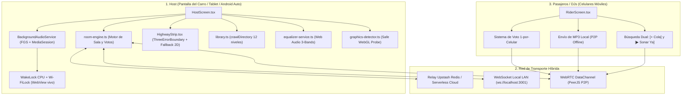

# 🚗 CarBeat: Collaborative In-Car Jukebox & DJ System (v2.2.0)

> **Desarrollador Principal:** Brayan Stid Cortés Lombana (`bscl`)  
> **Versión:** 2.2.0 (Producción Oficial)  
> **Despliegue en Vivo:** [https://carbeat-pi.vercel.app](https://carbeat-pi.vercel.app)

Sistema colaborativo de música en tiempo real para vehículos y viajes por carretera. Convierte la pantalla del carro (Tablet, radio Android china, Android Auto o navegador) en un reproductor central (Host) y permite que los pasajeros se unan como DJs desde sus teléfonos móviles sin instalar aplicaciones pesadas para buscar, pedir, votar canciones y controlar el ambiente musical de la cabina en vivo.

---

## 🌟 Novedades de la Versión 2.2.0 (Producción Oficial)

### 1. ⚡ Sonar Ya Dual (Buscador y Cola)
- **Buscador con Acciones Independientes:** En cada resultado de búsqueda tanto del carro como de los pasajeros, se presentan dos botones de acción claros:
  - **`[▶ Sonar ya]`**: Salta la cola y envía la pista a reproducirse inmediatamente en los parlantes del vehículo.
  - **`[+ Cola]`**: Encola la pista respetando el orden y los votos de los pasajeros.
- **Reproducción Directa en la Cola:** Cada canción encolada dispone de su propio botón `[▶ Sonar ya]` para permitir que el conductor o los pasajeros autorizados adelanten su turno al instante.
- **Permisos de Sala Configurables:** El conductor puede encender o apagar el permiso de que los pasajeros usen "Sonar Ya" desde el panel de *Modos > Reglas de la sala* (`passengerPlayNow`).

### 2. 🪪 Portada Limpia sin Código Residual
- **Entrada de Pasajero Vacía por Defecto:** Se eliminó la precarga automática de salas anteriores (`getLastRiderRoom()`).
- El campo de placa arranca **100% limpio y vacío (`""`)**, mostrando el placeholder `"VIBE-7KQ3"` para que el usuario introduzca el código del carro manualmente o utilice el escaneo de código QR.

### 3. 🛡️ Blindaje WebGL 2D/3D & Soporte para Radios Antiguas (Anti "Fallo en la cabina")
- **Detección Previa de Hardware (`graphics-detector.ts`):** 
  - Evalúa la capacidad real de compilación de shaders antes de intentar cargar WebGL.
  - Detecta pantallas de carro de gama de entrada o hardware embebido modesto (`navigator.deviceMemory <= 2 GB`, CPUs de 4 núcleos lentas).
  - En radios antiguas o sin GPU dedicada, activa automáticamente el **Modo 2D Ligero Atmosférico** (cero consumo de GPU, carga instantánea, sin bloqueos ni reinicios).
- **Envoltorio `<ThreeErrorBoundary>`:** Protege la autopista 3D de la cabina (`HighwayStrip.tsx`) y la portada (`Landing.tsx`). Si la GPU pierde contexto durante el viaje, conmuta silenciosamente a los letreros planos 2D sin tumbar la aplicación ni pausar el audio.
- **Auto-Recuperación en `ErrorBoundary.tsx`:** Si ocurre un fallo gráfico inesperado, persiste `setGraphicsPreference('2d')` de forma inmediata en `localStorage` para erradicar el bucle infinito de reinicios.

### 4. 🎛️ Ecualizador Car Audio Pro (Web Audio API)
- **Filtros Paramétricos Biquad:**
  - **Bajos / Subwoofer:** Filtro LowShelf calibrado en 80 Hz (-12 dB a +12 dB).
  - **Medios / Voces:** Filtro Peaking calibrado en 1 kHz (Q: 1.0).
  - **Agudos / Brillo:** Filtro HighShelf calibrado en 8 kHz.
- **Presets Automotrices de 1 Toque:** *Plano*, *Bajo Potente*, *Subwoofer Extremo*, *Voz Clara*, *Discoteca / Crossover*, *Rock / En Vivo*.
- **Modal Táctil Ergonómico:** Diseñado específicamente con diales y botones grandes para operación rápida en cabina.

### 5. 📁 Escáner USB Recursivo Profundo
- **Exploración Multinivel:** Recorre hasta 12 niveles de carpetas y subcarpetas anidadas en memorias USB conectadas a la radio del vehículo (`crawlDirectory`).
- **Soporte de Formatos:** Lee archivos `.mp3`, `.m4a`, `.wma`, `.flac`, `.wav`, `.aac`, `.ogg`, `.opus` sin distinción de mayúsculas.
- **IDs Universales Sin Fallas:** Implementa `generateLocalId()` de entropía segura sin depender de `crypto.randomUUID`, garantizando compatibilidad con WebViews antiguas de Android y entornos locales HTTP.

### 6. 📤 Envío de MP3 Locales Offline (P2P)
- Los pasajeros pueden compartir música descargada en sus celulares mediante el botón `[📤 Enviar MP3 local]` sin consumir internet en el carro.
- Los archivos se transmiten por el canal P2P directo (WebRTC DataChannel / LAN) y se añaden a la cola o al reproductor activo de forma autónoma.

### 7. ⭐ Guardado en 1 Toque para el Conductor
- Botón de favorito agrandado de alto contraste en el salpicadero (`RadioDisplay.tsx`), visible bajo la luz del sol.
- Permite al conductor guardar canciones en la memoria local permanente del vehículo con confirmación visual instantánea (*"¡Guardada en Mi Música!"*).

### 8. 🌙 Música con la Pantalla Apagada
- **Botón Luna en la Cabina:** En la barra superior (y en *Modos > Pantalla apagada*) hay un botón para dejar el panel en negro sin cortar la música. Un toque en la pantalla o el botón *Atrás* de Android la vuelven a encender.
- **Servicio en Primer Plano (APK):** `BackgroundAudioService.java` declara una sesión de reproducción `mediaPlayback` con `PARTIAL_WAKE_LOCK` y `WifiLock`. Mantiene vivo el WebView y la conexión de la sala mientras la pantalla está apagada o la app en segundo plano.
- **Controles del Sistema:** La notificación y la pantalla de bloqueo muestran título, carátula y botones *Anterior / Play-Pausa / Siguiente* (`MediaSession` nativa), que se traducen a acciones de la sala en JS.
- **Web / PWA:** Se usa la Media Session API del navegador para metadatos y controles; no se registra dos veces en el APK para no duplicar la notificación.
- **Por qué el modo luna y no el botón físico:** el reproductor de YouTube se pausa cuando Android apaga la pantalla de verdad. Bajar el brillo a cero y pintar una capa negra mantiene el WebView «visible», de modo que YouTube sigue sonando. Con el botón físico del equipo, YouTube puede pausarse por su propia política.
- **Se detiene al salir:** el servicio se apaga al cerrar la cabina o abandonar la pantalla del carro (`stopWithTask="true"`), evitando música fantasma tras cerrar desde *Recientes*.

**Archivos clave:** `BackgroundAudioService.java`, `BackgroundAudioPlugin.java`, `CarModePlugin.java` (`setScreenDim`), `src/core/audio/background-playback.ts`, `src/ui/useScreenOff.tsx`.

---

## 🏗️ Arquitectura del Sistema (CarBeat v2.2.0)



---

## 🧪 Pruebas y Aseguramiento de Calidad (QA)

CarBeat cuenta con una suite completa de **86 pruebas automatizadas** que certifican cada componente crítico:

* `shared/room-engine.test.ts`: Pruebas de cola, motor de votos, piloto automático y flag `playNow`.
* `shared/protocol.test.ts`: Validación de codificación y decodificación WireMessage.
* `server/relay.test.ts`: Pruebas de señalización y relay de salas.
* `tests/qa-functional-engine.test.ts`: Pruebas de integración de audio, favoritos y presets de ecualizador.
* `tests/qa-hardware-resilience.test.ts`: Pruebas de detección de hardware, simulación de radios sin GPU y recuperación 2D.
* `tests/qa-security-abuse.test.ts`: Pruebas DevSecOps, saneamiento de payloads XSS y límites de subida de audio.

```bash
# Ejecutar todas las pruebas
npm test

# Compilación estricta para producción
npm run build
npm run build:app
```

---

## 🚀 Despliegue y Flujo de Ramas Git (Regla 4)

El ciclo de desarrollo sigue el estándar de **3 ramas estrictas**:
1. `development`: Integración activa y refactorizaciones.
2. `qa`: Aseguramiento de calidad, staging y validación con los 86 tests.
3. `main`: Producción oficial desplegada automáticamente en Vercel.

```bash
# Sincronización nativa Android
npx cap sync android

# Despliegue en producción con Vercel CLI
npx vercel build --prod
npx vercel deploy --prebuilt --prod
```
